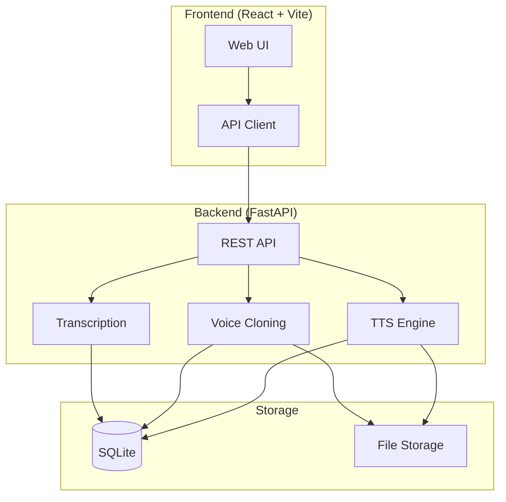

# VoiceStudio | Ryan Vo | AI & Machine Learning

> Work in progress. This checkpoint may be incomplete or fail tests. See PLAN.md and STATUS.md before use.


Open-source, fully-local voice cloning and TTS platform — voice cloning, voice design, video dubbing, dictation, transcription & audiobook creation.

## Problem

Voice synthesis tools are either cloud-dependent (ElevenLabs, OpenAI TTS) or difficult to self-host with poor documentation. VoiceStudio provides a complete local-first alternative with a usable web UI, REST API, and Docker deployment.

## AI/ML Approach

- **Text-to-Speech**: Local neural TTS models (Piper, Coqui XTTS-v2) for high-quality synthesis
- **Voice Cloning**: Speaker embedding extraction from reference audio for zero-shot cloning
- **Transcription**: Whisper.cpp for local speech-to-text
- **Translation**: Local NLLB/SeamlessM4T for multilingual support

## Intended User

Developers, researchers, and content creators who need voice synthesis without cloud dependency, data privacy concerns, or per-character costs.

## Quick Start

### Prerequisites

- Docker and Docker Compose
- 4GB+ RAM recommended

### Development

```bash
# Start all services
docker compose up --build

# Frontend: http://localhost:5173
# Backend API: http://localhost:8000
# API docs: http://localhost:8000/docs
```

### Local Development (without Docker)

**Backend:**
```bash
cd backend
python -m venv .venv
source .venv/bin/activate
pip install -r requirements.txt
uvicorn app.main:app --reload
```

**Frontend:**
```bash
cd frontend
npm install
npm run dev
```

## Architecture



## API Reference

### Health & Info
- `GET /health` — Service health check
- `GET /api/v1/info` — Application info

### TTS (Planned)
- `POST /api/v1/tts` — Generate speech from text
- `GET /api/v1/voices` — List available voices

### Voice Cloning (Planned)
- `POST /api/v1/voices/clone` — Create voice from reference audio
- `GET /api/v1/voices/:id` — Get voice details

### Video Dubbing (Planned)
- `POST /api/v1/dubbing` — Start dubbing job
- `GET /api/v1/dubbing/:id` — Get job status
- `GET /api/v1/dubbing/:id/download` — Download result

## Security Limitations

- No authentication in current skeleton (planned: OIDC with Keycloak)
- No rate limiting
- CORS configured for local development only
- File upload validation not yet implemented

## Provider Configuration

| Provider | Models | Config Vars |
|----------|--------|-------------|
| Piper | Local voices | `PIPER_MODEL_PATH` |
| Coqui XTTS-v2 | Multilingual | `XTTS_MODEL_PATH` |
| Whisper.cpp | Transcription | `WHISPER_MODEL_PATH` |

## SSO/SAML Setup

Keycloak realm import planned. See `docs/sso-setup.md` (to be created).

## License

MIT © Ryan Vo <ryandtvo@gmail.com>